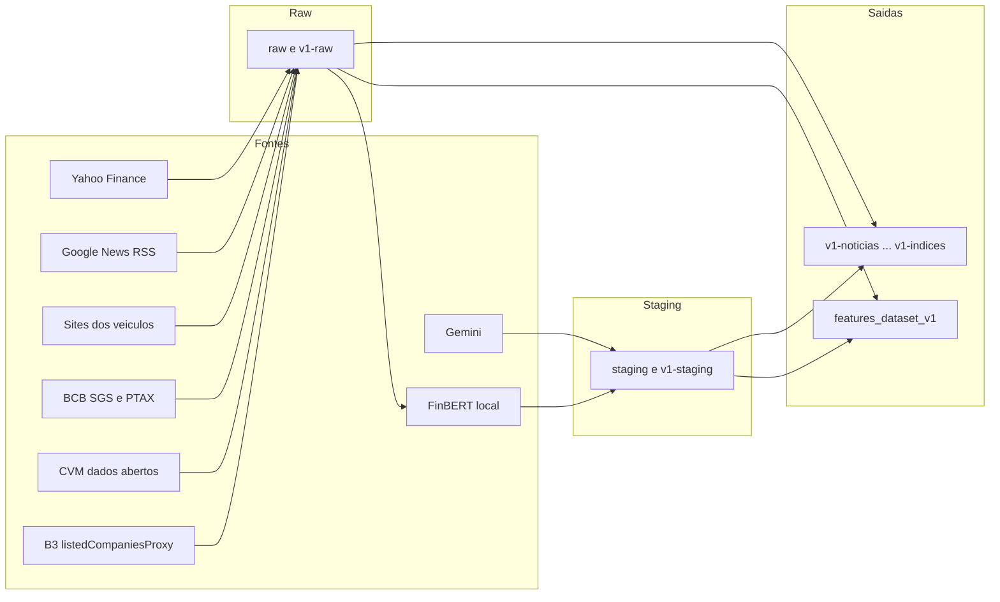
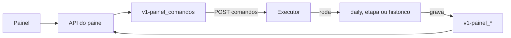

# Visão geral

Explica o que o sistema faz, de onde vem cada dado, como as camadas se organizam e o significado
dos termos usados nos demais documentos.

## 1. Objetivo

O sistema coleta notícias e dados de mercado da B3 e produz duas saídas:

1. **Dataset v1 (congelado).** Uma linha por (data, ticker), com 14 colunas: contagem de notícias,
   sentimento FinBERT, retornos de 1, 5 e 20 pregões, volatilidade, volume relativo, retorno do
   Ibovespa e alvo binário (`target`). Cobre a janela fixa definida em `DATA_START` e `DATA_END`
   (padrão de `config.py`: 2025-09-01 a 2026-09-01). A janela não muda.
2. **Entrega para a etapa seguinte.** Nove tabelas (`v1-noticias` a `v1-indices`, mais `v1-composicao_ibov`), com os mesmos
   nomes de colunas da [spec de entrega](spec-entrega-etapa-seguinte.md). São atualizadas todo dia
   de pregão, até as 20h (horário de Brasília).

A análise e a modelagem ficam fora deste repositório. Aqui termina a coleta, a limpeza e a montagem
das tabelas.

**Universo de ativos:** os 85 componentes do Ibovespa (`IBOV_TICKERS`). No histórico entram também
três empresas que saíram do índice (CRFB3, STBP3 e SRNA3), num total de 88. Além das ações, a
entrega de preços traz IBOV, USDBRL, BRENT e IVVB11.

**Restrição de custo:** zero, exceto a LLM do Google (Gemini) e o Jev, com teto de US$ 5 por mês para o Gemini. Essa conta
inclui a juíza de notícias e a análise diária. A juíza tem teto próprio de US$ 3 por mês, e o backlog tem verba única de US$ 15. O Jev é a segunda exceção paga, aprovada em 2026-10-23; o custo dele entra nas somas da juíza.

## 2. As duas pipelines

O código tem duas pipelines que compartilham tabelas de coleta. Cada uma tem seus comandos e sua
saída.

| | Dataset v1 (congelado) | Pipeline nova (entrega) |
|---|---|---|
| Objetivo | Base do TCC: 14 colunas por (data, ticker) | Nove tabelas para a etapa seguinte, com as colunas da spec (a nona, `v1-composicao_ibov`, não está na spec) |
| Janela | Fixa: `DATA_START` a `DATA_END`, com aquecimento de preços antes do início | Fim rolante: a coleta avança até hoje (`fim_coleta`) |
| Como roda | Um comando por fase: `collect-prices`, `collect-macro`, `collect-news`, `enrich`, `score`, `build-dataset` | `daily` com 9 etapas; `executor` como worker; `historico` para anos passados; comandos `collect-*`, `judge-news` e `build-entrega` |
| Saída | Tabela `features_dataset_v1`, mais Parquet e CSV (`build-dataset`) | Tabelas `v1-noticias` a `v1-indices`, e CSV com `build-entrega --csv` |
| Juíza e LLM | Não usa a juíza. A análise diária (`analyze-llm`) grava em `staging_llm_*` | A juíza filtra as notícias antes da entrega. A análise diária (etapa `analise`) não entra nas 9 tabelas |
| Tabelas | Nomes antigos, sem prefixo: `raw_articles`, `raw_prices`, `raw_macro`, `staging_article_sentiment` e outras | Tabelas novas com prefixo `v1-`, mais as de notícias, preços e macro que ela reaproveita |

A pipeline nova grava em `raw_articles`, `raw_prices` e `raw_macro`, as mesmas tabelas do v1. O v1
não sofre com isso, porque `build-dataset` lê apenas a janela fixa. O `features_dataset_v1` fica
intacto.

## 3. Arquitetura em camadas

Cada camada grava o próprio resultado. Quem está abaixo não depende de quem está acima para
existir.

| Camada | Prefixo | O que contém | Regra |
|---|---|---|---|
| Raw | `raw_` e `v1-raw_` | O que veio da rede, sem transformação: artigos, corpos, cotações, macro, balanços CVM, fatos relevantes IPE, cadastro B3, proventos B3 | Imutável e append-only. Reprocessar sempre parte daqui, nunca da rede |
| Staging | `staging_` e `v1-staging_` | Vínculo notícia-ticker, sentimento, julgamentos da juíza, análise diária por LLM | Substituível. Pode ser recalculada a partir do raw |
| Features e entrega | `features_dataset_v1`; `v1-noticias` a `v1-indices` | O dataset do v1 e as nove tabelas entregues | Upsert pela chave de cada tabela. Remontar sobrescreve, não duplica |
| Painel | `v1-painel_*` | Estado do executor: comandos, execuções, etapas, heartbeat, carga histórica, logs | Lido pela API do painel. Não entra no dataset |

Duas regras valem para todas as camadas:

- **Ausência é NULL, não zero.** Dia sem notícia tem contagem 0, mas sentimento nulo. Preencher com
  zero afirmaria uma medição que não existe.
- **Vazamento temporal é bug.** Uma feature em `t` só usa dados com timestamp `<= t`. Só o `target`
  olha `t+1`.

## 4. Fluxo de dados

O executor fica fora desse diagrama. Ele roda as etapas e grava o progresso em `v1-painel_*`:

O painel é a interface de acompanhamento, que fica no projeto `interface-acompanhamento`, fora deste
repositório. A API nunca chama o scraper: ela só grava o comando na fila. Detalhes em
[Executor e painel](07-executor-e-painel.md).

## 5. Fontes de dados

| Fonte | O que entrega | Precisa de chave de API? | Limite conhecido | Coletor |
|---|---|---|---|---|
| Yahoo Finance (chart API) | Cotações diárias das ações do universo, IBOV, BRENT (`BZ=F`) e USDBRL | Não | Sem limite documentado. Intervalo de 1 s por domínio | `collectors/prices_yahoo.py` |
| B3 (indexStatisticsProxy, `GetPortfolioDay`) | Fechamento diário dos índices IDIV, SMLL e IFIX, um ano por chamada. O Yahoo devolve só 1 dia deles | Não | Sem limite documentado. Intervalo de 1 s por domínio | `collectors/b3_indices.py` |
| Google News RSS | Notícias por ticker e contexto, em janelas semanais | Não | Satura em 100 itens por consulta. Por isso a coleta é semanal e a janela é subdividida ao bater 100 | `collectors/google_news.py` (intervalo de 2 s) |
| Link do Google News (`batchexecute`) | URL real do artigo a partir do link opaco | Não | Endpoint interno e não documentado. Quando falha, a notícia fica só com a manchete | `enrich/link_resolver.py` (intervalo de 0,4 s) |
| Sites dos veículos (allowlist) | Corpo do artigo, extraído com trafilatura | Não | Só veículos da allowlist. Intervalo de 1,5 s | `enrich/article_fetcher.py` |
| BCB SGS 432 e PTAX | Selic e dólar oficial (cotação de venda) | Não | Sem limite documentado. Intervalo de 0,5 s | `collectors/macro_bcb.py` |
| BCB SGS 12 e 433 | CDI diário e IPCA mensal | Não | A série diária aceita até 10 anos por requisição. A coleta busca ano a ano | `collectors/indices.py` |
| CVM dados abertos | Fatos relevantes e comunicados (IPE); cadastro das companhias; balanços ITR e DFP; ações emitidas | Não | Arquivos anuais em zip. Intervalo de 1 s | `collectors/cvm_ipe.py`, `cvm_cadastro.py`, `cvm_demonstracoes.py` |
| B3 listedCompaniesProxy | Setor, subsetor, tipo de ação (ON, PN ou UNIT) e composição das units (GetDetail por código CVM); proventos | Não | Intervalo de 1 s | `collectors/b3_cadastro.py`, `collectors/b3_proventos.py` |
| Gemini (Google) | Julgamento das notícias (juíza) e análise diária | Sim: `GEMINI_API_KEY` | Teto de US$ 5 por mês, compartilhado entre juíza e análise. A juíza tem teto mensal próprio de US$ 3 (`JUIZA_ORCAMENTO_MENSAL_USD`), verba de US$ 15 para o backlog e limite diário de itens (`JUIZA_MAX_ITENS_DIA`) | `llm/gemini_client.py`, `llm/juiza.py`, `llm/job.py` |
| JEV | Segundo julgamento de notícias, aprovado como exceção paga em 2026-10-23 | Sim | Desligado por padrão (`JEV_ENABLED=false`). Medido por concordância com o Gemini antes de decidir (`judge-news --concordancia`) | `llm/jev_client.py` |
| FinBERT (Hugging Face) | Sentimento: probabilidades de positivo, neutro e negativo, em pt e en | Não | Modelo local. Precisa do extra `sentiment` (torch) | `sentiment/finbert.py`, `sentiment/scoring.py` |

Os intervalos de cada fonte vêm de `config.py` (`throttle_*`). Toda requisição passa pela base
`collectors/base.Collector`, que aplica o intervalo por domínio, o retry e o checkpoint.

## 6. Glossário

| Termo | Significado no projeto |
|---|---|
| Pregão | Dia de negociação na B3. Os preços da entrega têm uma linha por pregão. |
| Data-com | Último dia em que a ação é negociada com direito ao provento. Quem tem a ação nesse dia recebe. |
| Unit | Certificado que junta ações ON e PN do mesmo emissor. Exemplo: KLBN11 = 1 ON + 4 PN. Os proventos da unit são compostos a partir dessas ações. |
| IPE | Informações periódicas e eventuais que a companhia envia à CVM. Inclui os fatos relevantes, que entram como notícias na entrega. |
| ITR e DFP | Balanços trimestral (ITR) e anual (DFP) entregues à CVM. |
| FinBERT | Modelo que classifica o tom de um texto em positivo, neutro ou negativo. Há versões para português e inglês, escolhidas pelo idioma do artigo. Roda localmente, sem API. |
| Juíza | Etapa que decide se cada par (notícia, ticker) é matéria real sobre a empresa. Aplica regras baratas primeiro; o que sobra vai ao Gemini. Notícias reprovadas saem da entrega. |
| Jev | Segundo julgador da juíza (TypeSafe AI), desligado por padrão e medido por concordância com o Gemini. |
| Daily | Execução das 9 etapas de um dia, na ordem do catálogo. Roda às 08:00 (Brasília) ou sob demanda. |
| Etapa | Uma das 9 partes do daily (`precos`, `noticias`, `entrega` e outras). O id é fixo, porque o painel usa esse nome. |
| Executor | Processo que fica ligado como worker. Recebe comandos do painel, roda o daily e a carga histórica e grava o progresso. |
| Painel | Interface de acompanhamento da execução. Lê as tabelas `v1-painel_*`. |
| Carga histórica | Coleta de anos passados, feita por coletor e por ano. Pode ser pausada, cancelada e retomada. |
| Fim rolante | Data final da coleta diária, que avança até hoje. É diferente da janela fixa do v1. |
| Aquecimento | Dias de cotação coletados antes de `DATA_START` (`PRICE_WARMUP_DAYS`, padrão 400). Assim as janelas de 20 pregões já estão cheias no primeiro dia do dataset. |
| `v1-` | Prefixo das 27 tabelas criadas pela pipeline nova, incluindo as 9 de entrega. As tabelas do dataset v1 mantêm o nome antigo. |
| Upsert | Gravação que cria a linha se a chave não existe e atualiza se ela existe. Uma chave repetida nunca gera linha duplicada. |

## 7. Limitações conhecidas

- **Panoramas de mercado entram nas notícias.** O Google News não separa "notícia sobre X" de
  "notícia que menciona X". Uma manchete como "Ibovespa recua com Vale e Petrobras" conta para
  essas empresas. Isso é uma limitação do método e deve ser citada no TCC.
- **Nomes comuns são qualificados na busca.** Para nomes que são palavras comuns, a busca usa termos
  de contexto (`SEARCH_QUALIFIERS` em `config.py`). Para nomes distintivos, não se aplica.
- **Empresas deslistadas.** CRFB3 fechou o capital e não tem código CVM, então entra só nas cotações
  e nas notícias. STBP3 e SRNA3 têm o código CVM cadastrado à mão.
- **Link do Google News.** A resolução depende de um endpoint não documentado. Quando ela falha, a
  notícia fica só com a manchete, sem corpo. A taxa de sucesso foi medida em 42 de 42 links reais.
