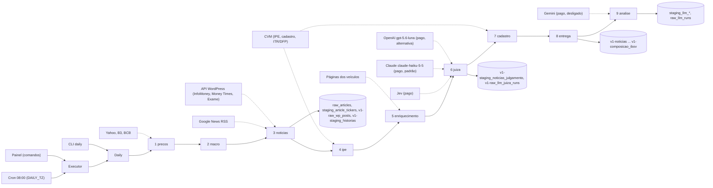

# Pipeline diária

Este documento cobre as nove etapas do `daily`, na ordem em que rodam: o que cada uma faz, de qual fonte vem o dado, a unidade de trabalho, as tabelas que grava e o que acontece quando falha. Cobre também o fim rolante da coleta, o orçamento de tempo, o prazo e os status da execução.

## Como a pipeline funciona hoje (2026-10-26)

Esta seção resume o que o código faz agora, de ponta a ponta. As seções 1 a 8 detalham cada parte. Fórmulas e custos da juíza estão em [04](04-juiza-e-llm.md).

### A. Quem dispara

- **Executor.** `python -m tcc_scraper.cli executor` roda em loop, sem parar. A cada `EXECUTOR_POLL_S` (5 s) busca comandos do painel, aplica, confirma e confere a agenda. Hoje ele roda na máquina do executor, não no Railway. A máquina atual é a "Processamento-Venturo": é o `host` gravado em `v1-painel_heartbeat` (conferido em 2026-10-26). No painel, o executor aparece como `EXECUTOR_HOST`. Se a variável estiver vazia, vale o nome da máquina.
- **Agenda (cron).** A partir de `DAILY_HORA` (08:00, no fuso `DAILY_TZ`), o executor cria um daily com origem `cron`, uma vez por dia (`executor/loop.py::_agendar_cron`). Se o executor subir depois do horário e ainda não houve cron no dia, o daily dispara na subida.
- **Painel.** Comandos `daily` (origem `manual`), `etapa` (uma etapa), `coletar` (coleta avulsa, ver [07](07-executor-e-painel.md), seção 4.1) e `historico` (carga histórica, ver [03](03-carga-historica.md)). Pausar, retomar e cancelar valem só para a carga histórica.
- **CLI, sem painel.** `python -m tcc_scraper.cli daily [--etapa ID]` roda no processo atual e espera o fim. Não respeita a prioridade da carga histórica.

Uma execução por vez. Um daily, uma etapa ou um `coletar` é recusado se já houver outra execução `agendada` ou `em_andamento`. Com carga histórica `em_andamento` ou `pausando`, o daily nasce `agendada` com `aguardando = historico` e começa quando a carga sai desses dois status (`orquestrador/daily.py`, `orquestrador/historico.py::bloqueia`).

### B. As etapas, na ordem real

Ordem de `orquestrador/etapas.py::ETAPAS`. As etapas rodam em sequência. Uma falha não para as seguintes.

| # | Id | O que faz | Fonte externa | Paga? |
|---|---|---|---|---|
| 1 | `precos` | Preços do universo, `^BVSP`, `BZ=F`, `USDBRL=X` e `IVVB11`; índices IDIV, SMLL e IFIX; carteira do IBOV | Yahoo Finance; B3 | Não |
| 2 | `macro` | Selic e PTAX; CDI e IPCA do ano corrente | BCB SGS (séries 432, 12 e 433) e PTAX | Não |
| 3 | `noticias` | Notícias de `fim_coleta − 2` até `fim_coleta`, em 3 partes: `google_news`, `wordpress` e `processar_wp` | Google News RSS e API WordPress (InfoMoney, Money Times, Exame) | Não |
| 4 | `ipe` | Fatos relevantes e comunicados do ano corrente | CVM (IPE) | Não |
| 5 | `enriquecimento` | Corpo dos artigos (só veículos da allowlist) e sentimento FinBERT, local | Páginas dos veículos; FinBERT | Não |
| 6 | `juiza` | Julga os pares (artigo, ticker) pendentes | Regra local; Jev; Anthropic `claude-haiku-5-5` | Sim (Jev e LLM) |
| 7 | `cadastro` | Cadastro das companhias, proventos e ITR/DFP | CVM; B3 | Não |
| 8 | `entrega` | Monta as 10 tabelas `v1-*` da entrega | Só o banco (tabelas `raw_*` e `staging_*`) | Não |
| 9 | `analise` | Análise diária por LLM | Gemini (hoje desligada, ver item E) | Sim, quando ligada |

As tabelas gravadas por etapa, e quando cada uma sai `falhou` ou `pulada`, estão na seção 4 deste documento.

### C. Status e orçamento

- **`concluida`.** A etapa rodou e não caiu em nenhuma regra de `falhou`.
- **`falhou`.** A etapa foi interrompida (orçamento ou cancelamento), todas as unidades falharam, uma exceção escapou, ou (juíza) a etapa parou por `jev_sem_chave`, `erro_jev` ou `sem_credito`.
- **`pulada`.** O orçamento estourou antes de a etapa começar, houve cancelamento, ou (análise) a etapa está desligada.
- **Execução `parcial`.** Pelo menos uma etapa `concluida` e pelo menos uma `falhou`.

Orçamento: `DAILY_ORCAMENTO_MIN` (90 minutos), contado a partir de `iniciada_em`.

- **Antes de cada etapa.** Se o orçamento estourou, a etapa sai `pulada` com o motivo `orçamento esgotado`. `entrega` e `analise` não são cortadas (`ETAPAS_SEM_CORTE`).
- **Durante a etapa.** `Progresso.deve_parar()` vale para cancelamento e para o prazo. Ele é checado entre unidades e entre lotes, nunca no meio de uma requisição. Se estourar, a etapa sai `falhou` com `interrompida: orçamento ou cancelamento`. O que já foi gravado fica no banco.
- **Status final da execução** (`orquestrador/daily.py::_rodar`). `falhou` se foi cancelada ou se nenhuma etapa ficou `concluida`. `parcial` se alguma etapa falhou. Nos demais casos, `concluida`.

### D. Juíza (etapa `juiza`)

A juíza percorre os pares pendentes em páginas de `JUIZA_PAGINA` pares. No diário, vai do mais recente para o mais antigo. Em cada página, a ordem é esta:

1. **Regra local** (`llm/juiza_regras.py::regra_barata`). Resolve os casos óbvios. Não custa nada e não conta no teto de itens.
2. **Jev** (só com `JEV_ENABLED=true` e `JEV_API_KEY`). Lotes de `JEV_LOTE` (50) pares, com trecho de `JEV_TRECHO` (1.500 caracteres). Com `JUIZA_JEV_MODO=entrega` (padrão), o Jev decide sozinho quando P(entra) ou P(não entra) passa de `JUIZA_JEV_LIMIAR_ENTREGA` (0,9) e concorda com a regra de entrega (`llm/juiza.py::_aceita_jev`). O que ele não decide segue para a LLM.
3. **LLM de fallback.** Com `JUIZA_PROVEDOR=anthropic` (padrão), usa `claude-haiku-5-5`, com `ANTHROPIC_EFFORT=medium`. Com `JUIZA_PROVEDOR=openai`, usa `gpt-5.6-luna`, com `OPENAI_REASONING_EFFORT=none`. Lotes de `JUIZA_LOTE` (50) pares, com trecho de 300 caracteres (`_TRECHO`). Não há busca na web. Com `JUIZA_PROVEDOR=gemini`, o provedor é o Gemini.

**Gravação.** Julgamento aceito vai para `v1-staging_noticias_julgamento`. Cada chamada paga (Jev ou LLM) vira uma linha em `v1-raw_llm_juiza_runs`, inclusive as que falharam. Par que a LLM não aceita ganha uma tentativa em `v1-staging_juiza_tentativas`. Ao chegar a `JUIZA_MAX_TENTATIVAS` (3), o par deixa de ser pendente.

**Tetos.**

- **Itens (diário).** `JUIZA_MAX_ITENS_DIA` (2.000) pares que gastam Jev ou LLM por execução. Conferido antes de cada página.
- **Dólares (diário).** `JUIZA_ORCAMENTO_MENSAL_USD` (US$ 3,00) menos o gasto de `producao` desde o dia 1 do mês, no fuso `DAILY_TZ`. Conferido antes de cada lote pago. O custo do Jev entra no mesmo teto (`llm/juiza_custo.py::teto_usd`).

**Paradas** (`ResultadoJuiza.parada`) e o status que cada uma gera na etapa:

| Parada | Quando acontece | Status da etapa |
|---|---|---|
| (nenhuma) | Não há mais pendentes, ou a execução acabou sem parada | `concluida` |
| `jev_sem_chave` | `JEV_ENABLED=true` sem `JEV_API_KEY`, com pares que a regra não resolveu | `falhou` (a LLM fica bloqueada) |
| `erro_jev` | Dois lotes seguidos do Jev com erro, ou erro 401, 402 ou 403 em todos os itens | `falhou` (a LLM não é chamada) |
| `sem_credito` | Anthropic sem crédito, OpenAI com `insufficient_quota`, ou Gemini com 402. Não há retry | `falhou` |
| `erro_api` | Dois lotes seguidos da LLM com erro de API | `concluida`, com os pares pendentes |
| `orcamento_usd` | Atingido o teto em US$ | `concluida`, com os pares pendentes |
| `teto_itens` | Atingido `JUIZA_MAX_ITENS_DIA` | `concluida`, com os pares pendentes |
| `cancelado` | Cancelamento, ou o fim do `DAILY_ORCAMENTO_MIN` no meio da etapa | `falhou` (interrompida) |

Sem a chave da LLM (`ANTHROPIC_API_KEY`, `OPENAI_API_KEY` com `JUIZA_PROVEDOR=openai`, ou `GEMINI_API_KEY` com `JUIZA_PROVEDOR=gemini`), a juíza registra o aviso `<provedor>_sem_chave`. A etapa sai `concluida` com a regra e o Jev aplicados, e os pares restantes ficam pendentes. Se `JUIZA_MODELO` for de outro provedor (por exemplo, `gemini-...` com `openai` ou `anthropic`), a juíza levanta `ValueError`, e a etapa sai `falhou` com essa mensagem.

Fórmulas, tetos e custos: [04](04-juiza-e-llm.md), seções 2 e 3.

### E. Análise diária (etapa `analise`)

- **Hoje desligada.** `ANALISE_ENABLED=false` é o padrão de `config.py` e de `.env.example`. A etapa sai `pulada` com o motivo `análise diária desativada (ANALISE_ENABLED=false)`. Sem `GEMINI_API_KEY`, sai `pulada` com o motivo `GEMINI_API_KEY ausente`.
- **Quando ligada,** a etapa chama `llm/job.py::run_daily_analysis` com o Gemini (`GEMINI_MODEL`), uma vez para o dia `fim_coleta`.
- **O comando manual `analyze-llm` também usa o Gemini.**
- **Estado do provedor.** O Gemini está sem crédito desde 2026-10-24: as chamadas devolvem 402 "prepayment credits are depleted" (registrado em `v1-raw_llm_juiza_runs` e `raw_llm_runs`). A migração da análise para a OpenAI está pendente.

### F. Diagrama do fluxo



### G. O que é pago e quanto

Medido em 2026-10-26. O `gpt-5.6-luna` era o provedor da LLM de fallback até 2026-10-28. O `claude-haiku-5-5` é o padrão desde então, e a linha dele é estimativa, ainda não medida:

| Item | Custo | Base da medição |
|---|---|---|
| Jev (`jev-1.13.0`) | ~US$ 0,000049 por par | ~1.155 tokens de entrada, 4 perguntas |
| `gpt-5.6-luna` (OpenAI, provedor anterior) | ~US$ 0,00009 por par (~US$ 0,00007 com cache) | Só recebe o que o Jev não decide |
| `claude-haiku-5-5` (Anthropic, padrão desde 2026-10-28) | US$ 0,000119 por par (medido em 2026-10-28, 300 pares, effort `medium`) | Só recebe o que o Jev não decide |
| Gemini, juíza antiga | ~US$ 0,00017 por par | Não é mais usado pela juíza |

Concordância em 500 pares: no limiar 0,9, o Jev decide ~69% dos pares, com 95,9% de concordância de entrega com o Gemini. Os ~31% restantes vão ao Luna.

Estimativa para o backlog de 13.144 pares (volume de 24/10):

- **Com o Luna, no provedor anterior (medido em 2026-10-26):** Jev em todos os pares (13.144 × 0,000049 ≈ US$ 0,64), mais o Luna em ~31% (≈ 4.075 × 0,00007 a 0,00009 ≈ US$ 0,29 a 0,37). Total: ~US$ 0,93 a 1,01, com referência de US$ 0,97.
- **Antes (só Gemini):** ~US$ 2,24.

São estimativas da medição, não fatura. Tetos: juíza diária, US$ 3 por mês. Verba do backlog, US$ 15 (`JUIZA_BACKLOG_VERBA_USD`).

### H. Carga histórica

- **Disparo.** Pelo painel (comando `historico`) ou pela CLI (`historico --anos ... --modo ...`). Roda em thread própria. Só uma carga por vez.
- **Passos** (`orquestrador/historico.py::_passos`). Globais, no ano mais recente: `yahoo`, `b3_indices`, `bcb`, `indices_bcb`, `cvm_cadastro`, `b3_cadastro`, `b3_proventos`, `cvm_itr_dfp`. Depois, por segmento de ano, do mais recente ao mais antigo: `google_news`, `cvm_ipe`, `enriquecimento`, `finbert`, `juiza`, `build_entrega`.
- **Juíza na carga.** Roda em modo `backlog` (`args_fixos`): do mais antigo para o mais recente, sem teto de itens. O limite é a verba de `JUIZA_BACKLOG_VERBA_USD` (US$ 15), cumulativa entre execuções.
- **Fora da carga.** A análise diária (`analise`) não entra na carga histórica. A carteira do IBOV (`b3_carteira_ibov`) também não, porque é só a foto do dia.
- Detalhes em [03](03-carga-historica.md).

### I. O que o `.env` da máquina do executor precisa ter

Os valores abaixo são o alvo. Os segredos ficam só no `.env`, nunca no repositório.

```bash
EXECUTOR_TOKEN=<token igual ao da API do painel>   # obrigatório
PAINEL_API_URL=<base da API do painel>             # obrigatório
EXECUTOR_HOST=<nome no painel>                     # opcional; vazio = nome da máquina
DAILY_HORA=08:00
DAILY_TZ=America/Sao_Paulo
DATA_FIM_COLETA=                                   # vazio no servidor
JEV_ENABLED=true
JEV_API_KEY=<segredo>
ANTHROPIC_API_KEY=<segredo>
JUIZA_PROVEDOR=anthropic
JUIZA_JEV_MODO=entrega
# JUIZA_MODELO= fora do .env, ou um modelo da Anthropic (claude-haiku-5-5 é o padrão; gemini-... com anthropic recusa a juíza)
ANALISE_ENABLED=false
```

`JUIZA_JEV_DECIDE` é obsoleta. Não a use.

Para conferir antes de deixar o executor rodar sozinho:

```bash
python -m tcc_scraper.cli judge-news --status
```

O comando mostra pendentes, gasto e verbas, sem julgar. Sem `ANTHROPIC_API_KEY` (ou a chave do provedor escolhido), a juíza não falha: deixa os pares pendentes. Por isso, confira o status antes de cada dia de publicação.

## 1. O que é o daily

Uma execução do `daily` roda as nove etapas em sequência, para o dia de referência (`fim_coleta`, seção 2). Ela nasce de três formas:

| Origem | Como dispara | `origem` gravada |
|---|---|---|
| Agenda | O executor cria o daily às `DAILY_HORA` (08:00, em `DAILY_TZ`), uma vez por dia | `cron` |
| Painel | Comando `daily` ou `etapa` enviado pela API do painel (ver [07](07-executor-e-painel.md)) | `manual` |
| CLI | `python -m tcc_scraper.cli daily`, bloqueante, sem painel | `manual`, ou o valor de `--origem` |

```bash
python -m tcc_scraper.cli daily                  # as 9 etapas
python -m tcc_scraper.cli daily --etapa precos   # so uma etapa; a execucao vira do tipo "etapa"
```

A CLI roda o daily no processo atual e não aplica a prioridade da carga histórica. Essa regra existe só no caminho do executor (ver [03](03-carga-historica.md), seção 7).

## 2. Dia de referência e janelas de coleta

- **Fim rolante.** O dia de referência (`fim_coleta`) é hoje, no fuso `DAILY_TZ` (padrão `America/Sao_Paulo`). A variável `DATA_FIM_COLETA` fixa outra data. Deixe-a vazia no servidor: ela serve só para reproduzir um dia. Nenhuma das duas mexe na janela do dataset (`DATA_START` e `DATA_END`).
- **Notícias.** Do dia `fim_coleta − 2` até `fim_coleta`. A busca do Google News usa `after:` com `fim_coleta − 2` e `before:` com `fim_coleta + 1`. InfoMoney, Money Times e Exame vêm da API WordPress: `wordpress` busca de `fim_coleta − 2` até `fim_coleta + 1` (exclusivo), e `processar_wp` processa a partir de `fim_coleta − 3`, para aquecer o boilerplate. Com `WP_ENABLED=true`, o Google News descarta os itens desses 3 domínios.
- **Preços.** Do `price_start` (`DATA_START` menos `PRICE_WARMUP_DAYS`, padrão 400 dias corridos) até `fim_coleta`, inclusive.
- **Juros e inflação.** CDI e IPCA do ano civil de `fim_coleta`.
- **Fatos relevantes (IPE) e demonstrações (ITR/DFP).** Só o ano civil de `fim_coleta`.

## 3. As nove etapas

Os ids, nomes e coletores são o contrato com o painel. Não renomear sem combinar com ele. O catálogo está em `src/tcc_scraper/orquestrador/etapas.py`.

| # | Id | Nome no painel | Coletor | Fonte | Unidade de trabalho | Retoma por checkpoint? |
|---|---|---|---|---|---|---|
| 1 | `precos` | Preços e índices | `yahoo` | Yahoo Finance, chart API (`adjclose`), e B3 (`GetPortfolioDay`, para IDIV, SMLL e IFIX) | Um ticker: o universo de coleta, `^BVSP`, `BZ=F`, `USDBRL=X`, `IVVB11`; depois, um índice da B3 no ano corrente (`b3\|<indice>\|<ano>`); por fim, a carteira do IBOV (`b3_carteira_ibov`, grava as mudanças em `v1-composicao_ibov`) | Não: refaz todos os tickers a cada dia |
| 2 | `macro` | Macro do BCB | `bcb` e `indices_bcb` | BCB SGS (Selic, série 432; CDI, série 12; IPCA, série 433) e PTAX (`cotacaoVenda`) | Uma série; depois, uma série por ano (`sgs\|<serie>\|<ano>`) | Não |
| 3 | `noticias` | Notícias | `google_news`, `wordpress`, `processar_wp` | Google News RSS, sem chave; API WordPress de InfoMoney, Money Times e Exame, sem chave; processamento local | Google: ticker × semana × idioma, na janela da seção 2. WordPress: site × mês | Não |
| 4 | `ipe` | Fatos relevantes | `cvm_ipe` | CVM, IPE (fatos relevantes e comunicados), arquivo anual | Um arquivo do IPE do ano (`ipe\|<ano>\|<Last-Modified>`) | Sim |
| 5 | `enriquecimento` | Corpo e sentimento | `finbert` | Página do veículo (só domínios da allowlist) e FinBERT local | Lote de artigos sem corpo; depois, bloco de textos sem sentimento | Não é preciso: só entram os pendentes |
| 6 | `juiza` | Juíza de qualidade | `juiza` | Regra local, sem API; depois Jev (se ligado; em `JUIZA_JEV_MODO=entrega`, decide por entrega segura); depois LLM de fallback (Anthropic `claude-haiku-5-5`, OpenAI `gpt-5.6-luna` ou Gemini, conforme `JUIZA_PROVEDOR`), sem busca na web | Lote de `JUIZA_LOTE` pares (artigo, ticker) pendentes, até `JUIZA_MAX_ITENS_DIA` por dia e até o teto mensal em US$ (`JUIZA_ORCAMENTO_MENSAL_USD`) | Só entram os pendentes |
| 7 | `cadastro` | Cadastro e eventos | `cvm_b3` | CVM (cadastro das companhias), B3 (`GetDetail` e proventos), CVM (ITR e DFP) | Quatro partes: companhia da CVM (`cad\|<Last-Modified>`), empresa da B3 (`detail\|<cd_cvm>`), empresa de proventos (`prov\|<issuing_company>`), arquivo ITR/DFP (`<tipo>\|<ano>\|<Last-Modified>`) | Só ITR/DFP (`resume=True`) |
| 8 | `entrega` | Montagem das 8 tabelas (nome do painel; a etapa grava 10) | `build_entrega` | Tabelas `raw_*` e `staging_*` já gravadas | As 10 tabelas da entrega | Refaz as 10 tabelas a cada execução |
| 9 | `analise` | Análise diária | `gemini` | Gemini, com busca Google e saída em JSON | Uma chamada, para o dia `fim_coleta` | Refaz o dia (apaga e regrava) |

Ordem de execução: `precos`, `macro`, `noticias`, `ipe`, `enriquecimento`, `juiza`, `cadastro`, `entrega`, `analise`. As etapas `enriquecimento` e `juiza` vêm antes de `entrega`, então a entrega do dia já sai com as notícias julgadas.

## 4. Tabelas gravadas e regra de falha

Só as 31 tabelas criadas pela pipeline nova (fontes novas, painel e entrega) têm o prefixo `v1-`. As demais mantêm o nome de camada (`raw_prices`, `raw_articles` etc.). Ver [06](06-banco-de-dados.md).

| Etapa | Tabelas que grava | Sai `falhou` quando | Sai `pulada` quando |
|---|---|---|---|
| `precos` | `raw_prices`, `raw_collection_runs`, `v1-composicao_ibov` | Foi interrompida (orçamento ou cancelamento), ou as três partes falharam (Yahoo, índices B3 e carteira do IBOV) | Orçamento esgotado antes de começar, ou cancelamento |
| `macro` | `raw_macro`, `raw_collection_runs` | Alguma parte foi interrompida, ou as duas partes falharam | Orçamento esgotado antes de começar, ou cancelamento |
| `noticias` | `raw_articles`, `staging_article_tickers`, `raw_collection_runs`; com `WP_ENABLED=true`, também `v1-raw_wp_posts`, `v1-staging_historias`, `v1-staging_wp_processamento` e `v1-staging_noticias_julgamento` (julgamento por código) | Foi interrompida, ou as três partes falharam (Google News, WordPress e processamento) | Orçamento esgotado antes de começar, ou cancelamento |
| `ipe` | `v1-raw_ipe_docs`, `raw_articles`, `staging_article_tickers`, `raw_collection_runs` | Foi interrompida, ou todas as unidades falharam | Orçamento esgotado antes de começar, ou cancelamento |
| `enriquecimento` | `raw_article_bodies`, `raw_articles` (coluna `resolved_url`), `staging_article_sentiment` | Foi interrompida, ou todas as páginas falharam, ou o FinBERT não está instalado (falta o extra `[sentiment]`). O corpo já gravado fica | Orçamento esgotado antes de começar, ou cancelamento |
| `juiza` | `v1-staging_noticias_julgamento`, `v1-raw_llm_juiza_runs` | Foi interrompida (orçamento ou cancelamento), ou parou por `jev_sem_chave`, `erro_jev` ou `sem_credito` (ver nota abaixo) | Orçamento esgotado antes de começar, ou cancelamento. Sem a chave da LLM de fallback (`ANTHROPIC_API_KEY`, `OPENAI_API_KEY` com `JUIZA_PROVEDOR=openai`, ou `GEMINI_API_KEY` com `JUIZA_PROVEDOR=gemini`), a etapa sai `concluida` sem julgar pela LLM (ver nota abaixo) |
| `cadastro` | `v1-raw_cvm_cadastro`, `v1-raw_b3_cadastro`, `v1-raw_b3_proventos`, `v1-raw_b3_suplemento`, `v1-raw_cvm_balancos`, `v1-raw_cvm_acoes` | Alguma parte foi interrompida, ou as quatro partes falharam | Orçamento esgotado antes de começar, ou cancelamento |
| `entrega` | As 10 tabelas `v1-noticias` … `v1-indices`, `v1-composicao_ibov` e `v1-eventos_acoes` (ver [05](05-entrega.md)) | Alguma das 10 tabelas falhou (a mensagem lista quais), ou nenhuma foi montada | Não é pulada pelo orçamento (ver seção 5) |
| `analise` | `raw_llm_prompts`, `raw_llm_runs`, `staging_llm_noticias_empresas`, `staging_llm_noticias_macro`, `staging_llm_acoes_sinais`, `staging_llm_mercados` | A chamada de análise não devolveu status `ok` | `ANALISE_ENABLED=false` (desligada hoje, ver a seção "Como a pipeline funciona hoje", item E) ou sem `GEMINI_API_KEY` |

Regras de falha, valem para todas as etapas:

- **Unidade com erro não derruba a etapa.** Ela fica contada em `unidades_erro`, e a última falha aparece em `ultimo_erro_unidade` e `ultimo_erro_mensagem`. A etapa só sai `falhou` se nenhuma unidade deu certo, ou se foi interrompida.
- **Exceção que escapa da etapa** vira `falhou`, com a mensagem `TipoDoErro: texto`. A execução segue para a etapa seguinte.
- **Etapas com várias partes** (`macro`, `cadastro`, `noticias`): uma parte que levanta exceção não impede as outras. Na `noticias`, a etapa só sai `falhou` se as três partes falharem.
- **Juíza sem chave.** Sem a chave da LLM de fallback (`ANTHROPIC_API_KEY`, `OPENAI_API_KEY` com `JUIZA_PROVEDOR=openai`, ou `GEMINI_API_KEY` com `JUIZA_PROVEDOR=gemini`), a etapa registra um aviso e sai `concluida`, com a regra local e o Jev aplicados. Os pares que restaram ficam pendentes e entram na próxima execução. A etapa não sai `pulada` nesse caso.
- **Paradas da juíza.** `jev_sem_chave` (`JEV_ENABLED=true` sem `JEV_API_KEY`: a LLM fica bloqueada), `erro_jev` (lote do Jev falhou 2 vezes seguidas, ou 401, 402 ou 403 em todos os itens: o lote fica pendente e não vai à LLM), `sem_credito` (Anthropic sem crédito, OpenAI com `insufficient_quota`, ou Gemini com 402; sem retry) e `cancelado` (cancelamento ou fim do orçamento no meio da etapa) deixam a etapa `falhou`. Paradas `erro_api`, `orcamento_usd` e `teto_itens` deixam a etapa `concluida`, com os pares pendentes para a próxima execução. Ver a seção "Como a pipeline funciona hoje", item D, e [04](04-juiza-e-llm.md), seção 2.9.

## 5. Orçamento, prazo e status

**Orçamento.** `DAILY_ORCAMENTO_MIN` (padrão 90 minutos) é contado a partir de `iniciada_em` da execução, que é o instante em que ela de fato começa (não o da criação). Há dois efeitos:

- Antes de cada etapa, se o orçamento estourou, a etapa sai `pulada` com o motivo `orçamento esgotado`. A exceção são `entrega` e `analise`, que rodam mesmo assim.
- Durante uma etapa, cada coletor confere o prazo antes de cada unidade. Ao estourar, para e a etapa sai `falhou` com o motivo `interrompida: orçamento ou cancelamento`. As unidades já gravadas ficam no banco.

**Prazo.** `DAILY_PRAZO_HORA` (padrão 20, no fuso `DAILY_TZ`) define `prazo_em` da execução: a hora-alvo para o dia estar publicado. O painel mostra esse campo. O código não cancela nada quando o prazo passa.

**Status da etapa** (`v1-painel_etapas.status`): `pendente`, `em_andamento`, `concluida`, `falhou`, `pulada`. A etapa fica `pendente` até começar. Se a execução for interrompida por reinício do processo, as etapas que ainda não começaram continuam `pendente`.

**Status da execução** (`v1-painel_execucoes.status`):

| Status | Quando |
|---|---|
| `agendada` | Criada, mas ainda não começou. Também usado quando a carga histórica tem prioridade (ver [03](03-carga-historica.md), seção 7) |
| `em_andamento` | Rodando |
| `concluida` | Ao menos uma etapa `concluida` e nenhuma `falhou`. Etapas `pulada` não contam como falha |
| `parcial` | Ao menos uma etapa `concluida` e ao menos uma `falhou` |
| `falhou` | Nenhuma etapa `concluida` (por exemplo, todas `pulada`), ou a execução foi cancelada, ou foi interrompida por reinício do processo |

**Uma execução por vez.** Criar um daily ou uma etapa é recusado enquanto houver outra execução `em_andamento` ou `agendada`.

**Id da execução.** `<data>-<tipo>-<HHMMSS>`, com data e hora da criação no fuso `DAILY_TZ`. Exemplo: `2026-10-19-daily-183000`.

## 6. Logs

- Cada etapa grava uma linha no início e outra no fim em `v1-painel_logs`, com `origem = 'daily'` e a coluna `etapa`.
- Durante a execução, todo aviso ou erro de `tcc_scraper.*` (nível WARNING ou acima) também vai para `v1-painel_logs`.
- `v1-painel_logs` não tem coluna de id da execução. Para ligar uma linha à execução, use o horário e a etapa.
- Os logs com mais de `PAINEL_LOGS_DIAS` dias (padrão 7) são apagados quando o executor sobe, não em tempo real (ver [07](07-executor-e-painel.md), seção 9).

## 7. Quando uma etapa falha

1. Veja o estado das etapas da execução:

```sql
SELECT etapa_id, status, unidades_feitas, unidades_erro, ultimo_erro_unidade, ultimo_erro_mensagem
FROM `v1-painel_etapas`
WHERE execucao_id = '<id-da-execucao>'
ORDER BY ordem;
```

2. Veja os avisos e erros da etapa:

```sql
SELECT ts, nivel, etapa, mensagem
FROM `v1-painel_logs`
WHERE origem = 'daily' AND etapa = '<id-da-etapa>'
ORDER BY ts DESC
LIMIT 50;
```

3. Rode só a etapa de novo: `python -m tcc_scraper.cli daily --etapa <id>`. Os coletores com checkpoint pulam o que já deu certo. Os demais refazem a coleta inteira (coluna "Retoma por checkpoint" da seção 3). As etapas `entrega` e `analise` regravam o dia.

Nomes com hífen, como `v1-painel_etapas`, precisam de crases em SQL escrito à mão.

## 8. Limitações e pontos em aberto

- **Prazo não é imposto.** `prazo_em` é uma hora-alvo. Uma execução que passa das 20 h continua rodando.
- **Orçamento não corta no meio de uma requisição.** O corte acontece entre unidades. Por isso a execução pode passar um pouco dos 90 minutos.
- **Juíza sem chave da LLM** conclui sem julgar pela LLM. Quem olha só o status `concluida` não vê que há pares pendentes. O log da etapa mostra o aviso.
- **Análise desligada ou sem chave** sai `pulada`. A execução pode ficar `concluida` mesmo assim, se as outras etapas deram certo.
- **Uma execução só por processo.** O estado do daily fica em memória. Ver [07](07-executor-e-painel.md), seção 9.
- **A CLI `daily` não respeita a prioridade da carga histórica.** Ver [03](03-carga-historica.md), seção 7.
- **Jev desligado por padrão.** Com `JEV_ENABLED=true` e `JEV_API_KEY`, a própria juíza cria o cliente Jev. Com `JUIZA_JEV_MODO=entrega` (padrão), ele decide por entrega segura. Com `JEV_ENABLED=true` e sem a chave, a etapa para com `jev_sem_chave`. Ver [04](04-juiza-e-llm.md).

Ver também: [01 Visão geral](01-visao-geral.md), [03 Carga histórica](03-carga-historica.md), [07 Executor e painel](07-executor-e-painel.md), [ADR](ADR.md).
